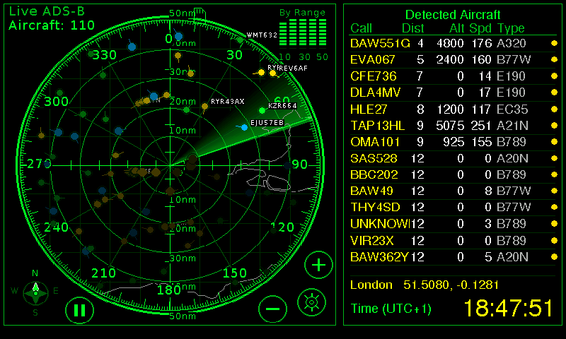
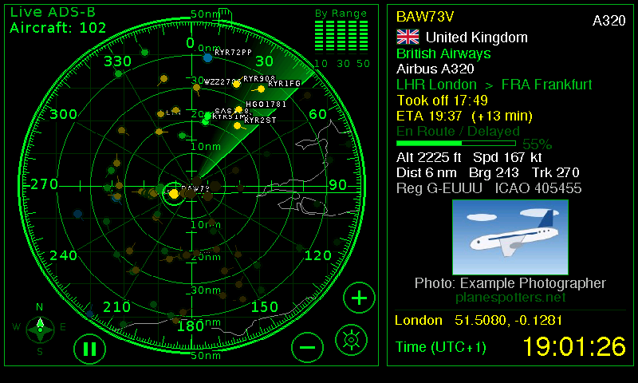
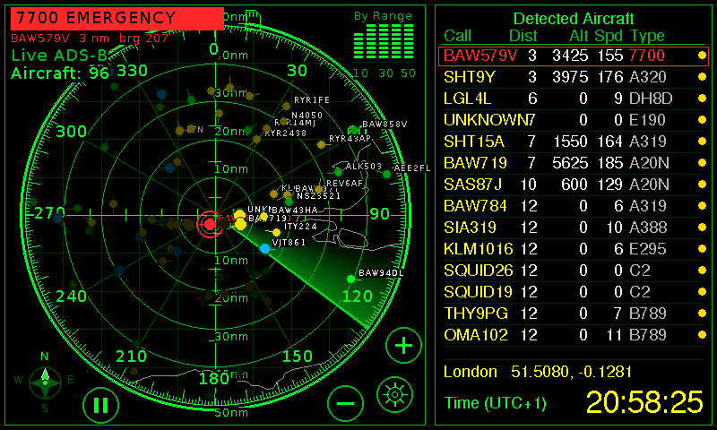
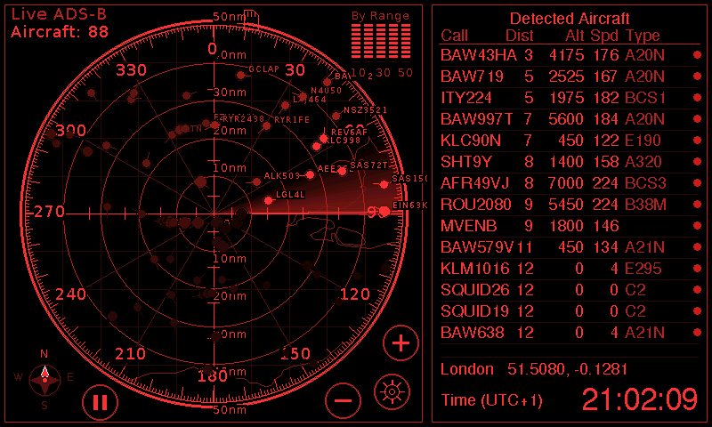

# ESP32 ADS-B Radar

A live air-traffic radar on a 7" ESP32-S3 touch display. Aircraft come from the free [airplanes.live](https://airplanes.live) data service over Wi-Fi, so
there is no antenna, SDR or receiver to build. A rotating sweep, aircraft marks with callsigns, a nearest-aircraft table, and a card for any aircraft you tap:
airline, model, route, **country of registration with its flag** and, with your own optional keys, **take-off time, ETA, the flown track and a photo**.

   

   

Pictures of the real screen over a demo location (central London, live traffic). In the card picture the route, times and the plane photo come from a stand-in
for the FlightAware and Planespotters services (made-up flight details, a drawn picture): see <a href="docs/screenshots/README.md">docs/screenshots</a>.

## Hardware
**VIEWE UEDX80480070E-WB-A**: a 7-inch 800×480 IPS RGB display with GT911 capacitive touch, built around an ESP32-S3-N16R8 (16 MB flash, 8 MB octal PSRAM), with Wi-Fi and a microSD slot. No soldering.

- Vendor: VIEWE ([viewedisplay.com](https://viewedisplay.com)), on GitHub at **[github.com/VIEWESMART](https://github.com/VIEWESMART)**
- This board's documentation, schematic and examples: **[VIEWESMART/UEDX80480070ESP32-7inch-Touch-Display](https://github.com/VIEWESMART/UEDX80480070ESP32-7inch-Touch-Display)**
- Product page: [VIEWE ESP32 7-inch 800×480 RGB IPS display](https://viewedisplay.com/product/esp32-7-inch-800x480-rgb-ips-tft-display-touch-screen-arduino-lvgl-uart/)
- Where to buy: one source is this [AliExpress listing](https://aliexpress.com/item/1005007714673111.html). Before ordering, check that the board is the model above (ESP32-S3-N16R8: 16 MB flash, 8 MB PSRAM): the firmware's two update slots need the 16 MB flash.
- **A 3D-printed stand / enclosure is coming soon.**

The pin map, display timing and the display fix in this firmware are specific to this model. VIEWE sells other sizes under similar names (`UEDX…`); they have different pins and are **not** supported.
What was measured on this board (display clock, touch, PSRAM, SD, Wi-Fi) is in [docs/hardware-findings.md](docs/hardware-findings.md).

## What it does
- **Radar screen** at 30 frames a second: sweep with a fading trail, range rings, seven ranges from 10 to 250 nautical miles (pinch or buttons), altitude-coloured marks with callsigns, a table of the
  nearest aircraft, optional coastlines / borders / airports behind the radar (offline, from Natural Earth).
- **Aircraft card:** tap a mark or a table row. Airline name from the callsign, readable model, origin → destination, altitude, speed, distance, bearing, track, registration,
  ICAO address, and the **country of registration with a flag**, worked out offline from the ICAO address blocks.
- **Optional flight details** (off until you switch them on): your own **FlightAware AeroAPI** key adds take-off time, ETA, delay, progress and the flown **track** drawn on the
  radar; **Planespotters** photos (credited on screen) need only a contact e-mail address.
- **Emergency squawks** (7500 / 7600 / 7700): a red mark with rings, a red table row, a blinking banner. It overrides night mode and the colour choice, at full brightness.
- **Night mode:** dim and all red, always, never, or automatic while the sun is down at your location.
- **Everything is configurable on the device or from a phone / PC browser** (`http://radar.local`): units (nm/km/mi, ft/m/FL, kt/km/h/mph), colours for the radar, titles, callsigns,
  values and lines/buttons, fonts, brightness, location (city search, coordinates, offline map, or "use this device's location"), country and time zone (automatic), Wi-Fi.
- **First-time setup without a keyboard:** the radar opens its own Wi-Fi and a captive portal; scan the QR code on its screen, choose your network, done. It keeps the old network
  if the new one fails, and reconnects by itself after an outage.
- **SD card logging** (optional): one CSV of sightings per day and a system log, written in the background, safe to unplug.
- **Over-the-air updates** from the phone page, from a link, or with PlatformIO; the new firmware is checked completely before anything is written, and the radar goes back to the old
  one by itself if the new one does not start properly.
- **Built to run unattended:** watchdogs, automatic recovery, an hourly health line in the log.

## Quick start
1. Install [PlatformIO](https://platformio.org/install) (the command line is enough).
2. `git clone https://github.com/gargamel778/ESP32-ADSB-Radar.git`, then `cp config/secrets.h.example config/secrets.h` (optional first-boot Wi-Fi and location) and
   `cp firmware/platformio.local.ini.example firmware/platformio.local.ini` (set the serial port).
3. Connect the **USB-C port labelled UART**, then `cd firmware && pio run -t upload`. The **first build takes about 15 minutes** (it rebuilds the ESP32 libraries once with a display fix) and later ones about 20 seconds. If the first build stops during the library stage (a `get_metavar` error is a known hiccup), run the same command again: it resumes.
4. The radar starts, shows the setup screen, and opens the Wi-Fi `ADSB-Radar-XXXX`. Scan the QR code, pick your network, set your location. Aircraft appear within seconds.

Details: [docs/BUILDING.md](docs/BUILDING.md). Using it: [docs/USER_GUIDE.md](docs/USER_GUIDE.md).

## Documentation
| | |
|---|---|
| [docs/USER_GUIDE.md](docs/USER_GUIDE.md) | Every screen, setting and feature; FlightAware and photo setup; troubleshooting |
| [docs/BUILDING.md](docs/BUILDING.md) | Toolchain, first build, flashing, over-the-air updates, test builds |
| [docs/ARCHITECTURE.md](docs/ARCHITECTURE.md) | How it is put together: tasks, memory, the display pipeline, data flow |
| [docs/WEB_API.md](docs/WEB_API.md) | The HTTP interface of the radar |
| [docs/SECURITY.md](docs/SECURITY.md) | What is protected how, and what is not |
| [docs/TESTING.md](docs/TESTING.md) | The test suites, how to run them, and the results |
| [docs/DATA_SOURCES.md](docs/DATA_SOURCES.md) | Where every piece of data comes from, and under which licence |
| [docs/hardware-findings.md](docs/hardware-findings.md) | What was measured on the board (display clock, touch, PSRAM, SD, Wi-Fi) and the gotchas |
| [docs/DEVELOPMENT_LOG.md](docs/DEVELOPMENT_LOG.md) | The plan and the notes of each milestone |

## Repository layout
| Path | What |
|---|---|
| `firmware/` | The radar firmware (PlatformIO project, Arduino framework on ESP-IDF 5.4) |
| `firmware/data/` | Embedded data: cities / time zones, world and map outlines, airline names, flags, the web page |
| `tools/` | Generators for the embedded data, the soak-test tool, mock servers, screenshot helpers, privacy scan |
| `tests/` | Host-side C++ tests, Python project tests, tests against a real radar |
| `hardware-tests/diag/` | Bring-up diagnostic firmware (display, touch, PSRAM, SD, Wi-Fi, API) |
| `config/` | `secrets.h.example`: optional first-boot Wi-Fi and location |
| `reference/original-mircemk/` | The CrowPanel sketch this project started from (GPL-3.0), unmodified, with attribution |

## Status
Milestones 0 to 8 are complete and tested on the hardware; milestone 8 (hardening, night mode, emergency squawks, flight details) is implemented and passed a 41-hour soak test (no restarts, no memory leak) on the build before the last fixes; a new soak of the release build is pending.
See [docs/TESTING.md](docs/TESTING.md) for what has been verified and what has not (notably: the FlightAware answers are tested against a stand-in server, not yet against a real key).

## Please be a good neighbour
The radar asks airplanes.live for aircraft every 5 seconds and keeps well under their request limit; keep it that way if you change the code. FlightAware bills per call: the firmware limits itself to
60 calls an hour and caches results, but the key and the bill are yours. Planespotters asks for credit to the photographer; the radar shows it under every photo. This project is not affiliated with
or endorsed by VIEWE, airplanes.live, FlightAware or Planespotters. **It is a hobby display, not a navigation or safety tool.**

## Licence and credits
GPL-3.0-or-later (see [LICENSE](LICENSE)). It started as a port of mircemk's *Real-Time Air Traffic Radar using ESP32 ADS-B Data* (GPL-3.0-or-later, see
[reference/original-mircemk/ATTRIBUTION.md](reference/original-mircemk/ATTRIBUTION.md)). Third-party data and code are listed with their licences in
[docs/DATA_SOURCES.md](docs/DATA_SOURCES.md): GeoNames (CC BY 4.0), Natural Earth, the tz database, OpenFlights (ODbL), OpenStreetMap and Leaflet (phone page), stb_image (public domain),
LovyanGFX, ArduinoJson.
