# User guide

## The radar screen

The left side is the radar: your location is the centre, north is up, the outer ring is the chosen range, the four inner rings are fifths of it. A sweep turns once every 4.5 seconds and
leaves a fading trail. Every aircraft is a mark that lights up when the sweep passes and then dims (it never disappears while it is being tracked); its callsign shows for a moment after the sweep.

| Mark colour | Altitude |
|---|---|
| blue | 30,000 ft (FL300) and above |
| green | 10,000 – 30,000 ft |
| yellow | below 10,000 ft |
| red | reported below sea level |

The small line on a mark points along the aircraft's track. A bigger mark means a higher or a closer aircraft.

- **Top left:** status text: *Live ADS-B*, the aircraft count, the age of the data and (if enabled) the display mode. Warnings are shown here in orange: *Stale: no response*, *Setup Wi-Fi is on*. An SD-card icon at the right shows logging state.
- **Top right:** *By Range*, a bar chart of the aircraft in each fifth of the range.
- **Corners:** `+` and `−` zoom, the pause button freezes the sweep, the gear opens **Settings**. Pinching the radar with two fingers also zooms.
- **Right panel:** *Detected Aircraft*: the nearest aircraft with distance, altitude, speed and type; the colour dot shows altitude. Tap a column title (*Dist*, *Alt*, *Spd*) to cycle its unit. Below it your place and coordinates, and the local time: tap *Time* to switch 12/24 hour, tap the digits to change the clock font.

### The aircraft card
Tap an aircraft mark or a row in the table. The card replaces the table:

 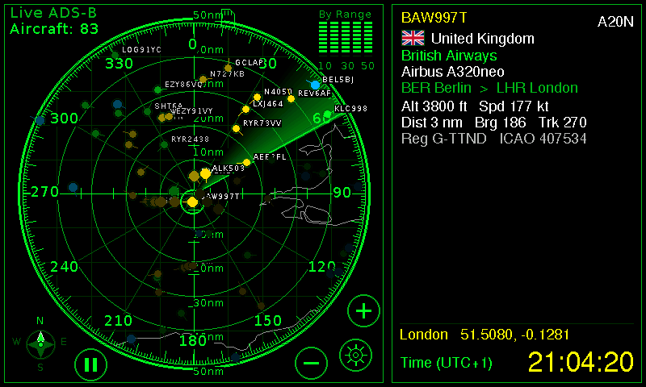

Left: with FlightAware and photos switched on (the route, times and photo here are from a stand-in service). Right: the default, without them.

- the **callsign** and aircraft type, the **flag and country of registration** (from the aircraft's ICAO address), the airline (from the callsign: *El Al* for ELY382) and the readable model (*Airbus A320*);
- the **route**, origin → destination, and how long ago the aircraft took off and when it is expected to land if FlightAware is switched on (see below);
- altitude, speed, distance and bearing from you, track, registration and ICAO address;
- a **photo** of the airframe, with the photographer's name, when Planespotters has one.

If FlightAware is on, the **flown track** is drawn as a line on the radar. Tap the card, an empty part of the radar, or the same aircraft again to bring the table back. While a card is up, other aircraft are picked by tapping their marks.

Country and flag need no network and no key: ICAO gives every country a block of aircraft addresses, so the address alone tells where an aircraft is registered. The flags are small, simplified drawings.

### Emergency squawks

An aircraft transmitting 7500 (hijack), 7600 (radio failure) or 7700 (general emergency) gets a **filled red mark with two heavy rings**, a red label with the code, a red frame around its row and card,
and a **blinking banner** at the top left with callsign, distance and bearing. The highlight is always red and at full brightness, even in night mode and whatever colours you chose; the override stays for two minutes
after the squawk disappears. A new emergency is also written once to the SD log. It is a real signal from the aircraft's transponder, so most are brief and some are mistakes: do not panic.

### Night mode

*Settings > Radar > Night Mode*: **Off**, **Auto** (on while the sun is more than one degree below the horizon at your location; needs the clock), or **On**. Night mode dims the backlight to the *night
brightness* (default 10 %, set with the brightness row of *Look*) and shows everything in red, the colour that spares night vision. The state is remembered across restarts.

## Settings
Open with the gear. Tabs on the left; changes apply at once and are saved a few seconds later.

| Tab | Rows |
|---|---|
| **Radar** | Range (10 – 250 nm, or the km / mi equivalents); sweep trail length; sweep running / paused; diagnostics on the radar screen on / off; **map overlay** (coastlines, borders, airports); **night mode** |
| **Units** | Units from country (default: follows the country of your location), distance nm / km / mi, altitude ft / m / flight level, speed kt / km/h / mph, 12 / 24 hour clock |
| **Look** | Font of the table (Sans / MonoBold / DejaVu); colour of the radar, of titles, of callsigns, of values, and of **lines & buttons** (frames, separators, buttons); brightness |
| **Location** | Where the radar is centred: search a city, type coordinates, pick on an offline map, choose the country and time zone (both follow the location unless you choose them) |
| **Wi-Fi** | Current network, change network (scan, on-screen keyboard), set up from a phone, the web address, the **web PIN**, the IP address |
| **Flights Data** | FlightAware on / off, API key, contact e-mail, plane photo, flight track, test the key, the last lookup's result |
| **Log** | SD card size and free space, logging on / off, how often an aircraft is logged (10 / 30 / 60 s), today's rows, eject / mount the card, view log files |
| **System** | Display mode, restart, tear test, firmware version and slot, credits |

  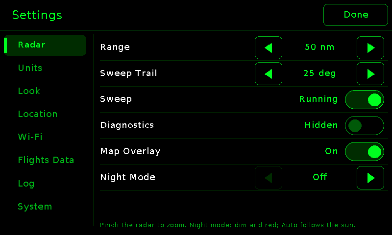 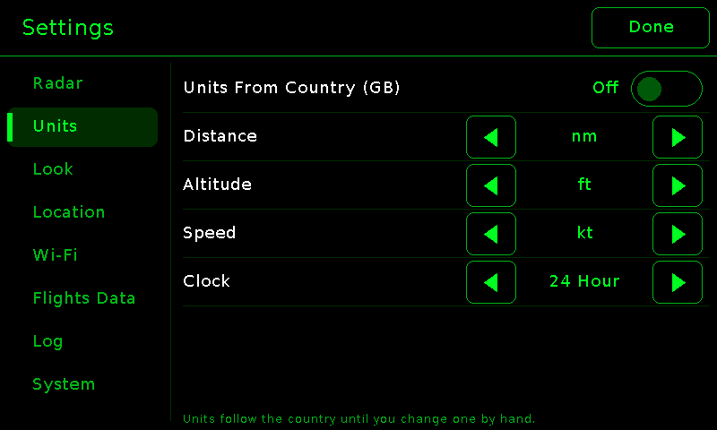 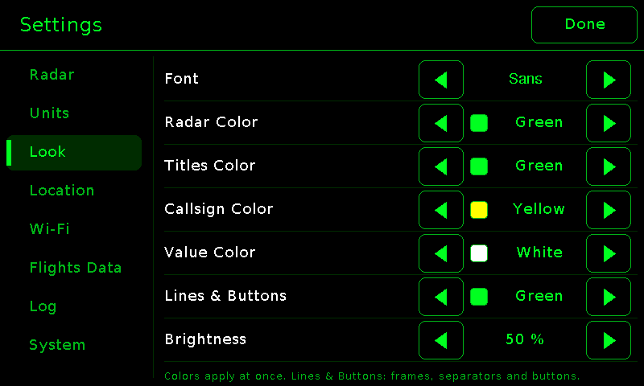
  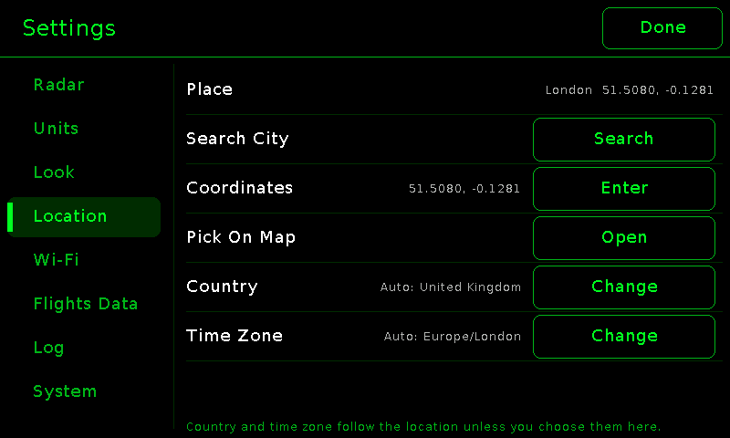 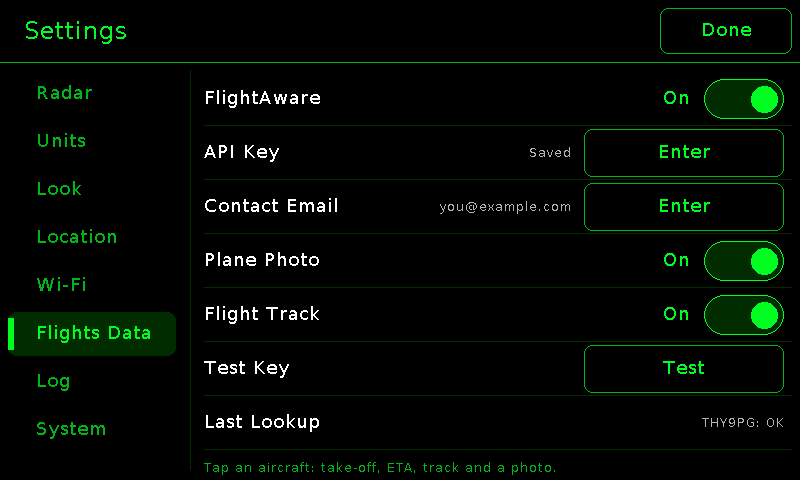 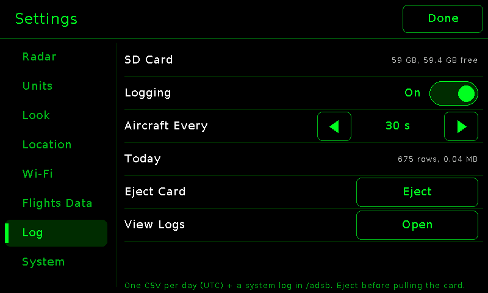
  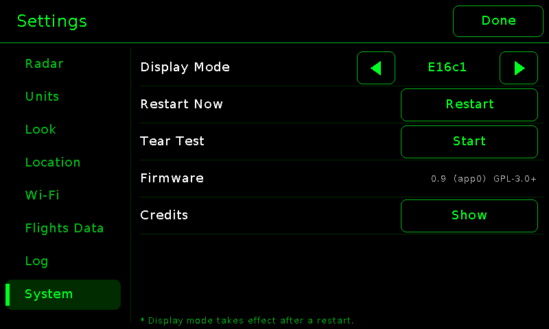

## From a phone or PC
Open `http://radar.local` (or the IP address shown under Settings > Wi-Fi). It asks for the **PIN** shown on the radar under Settings > Wi-Fi > Web PIN; the PIN stays valid until you
change it by erasing the settings. The page has the same settings plus: a map to pick the location, "use this device's location", firmware update, SD card controls and a status line.
It works on any recent browser and needs nothing from the internet except the map tiles of the location picker.

  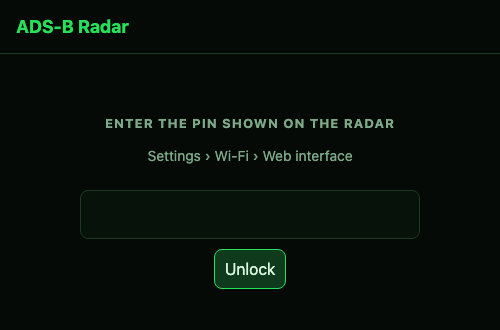 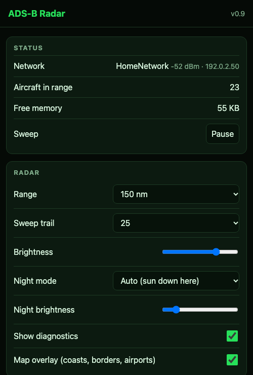 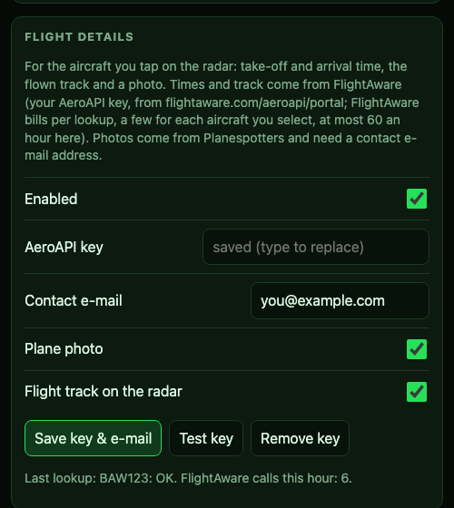 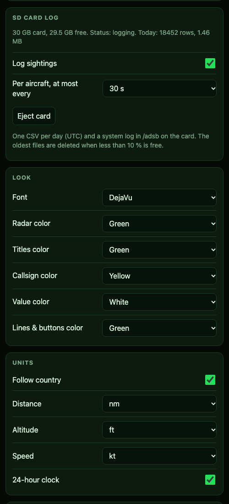

The page from the demo server (<code>tools/mock_radar.py</code>), with a made-up network name and address.

Some browsers only offer "use this device's location" on secure (HTTPS) pages; the radar speaks plain HTTP on your own network, so on those you pick the place on the map or type the coordinates instead.

## Setting up Wi-Fi
- **No network saved, or the saved one cannot be found for 30 seconds:** the radar opens its own access point `ADSB-Radar-XXXX` and keeps it up. The screen shows a QR code with the access point's
  name and password. Scan it with a phone (or join by hand), the setup page opens (it behaves like a captive portal), choose your network and enter its password.
- **Later:** *Settings > Wi-Fi > Setup From Phone* opens the access point for as long as the setup screen is on the display. The access point switches off a few seconds after the radar has joined your network, and the phone's sign-in sheet closes.
- **On the radar itself:** *Change Network* scans and lets you type the password on the touch keyboard (*Show* reveals what you typed).
- A new network is tried for up to 20 seconds. If it does not work (wrong password, out of range) the radar goes back to the previous one, so a typo never strands it. After a router outage it reconnects by itself, and restarts as a last resort if it has been offline for 30 minutes.

## Flight details (FlightAware and photos)
Both are off until you enable them in *Settings > Flights Data* (or on the phone page). Nothing is requested until you tap an aircraft and keep it selected for about a second and a half.

**FlightAware (take-off time, ETA, delay, progress, the flown track, a better route).** You need your own AeroAPI key: create an account at [flightaware.com/aeroapi](https://www.flightaware.com/aeroapi/portal),
choose the *Personal* tier and copy the key. FlightAware bills per call (a small free monthly allowance applies to the Personal tier, larger if you feed ADS-B data to FlightAware; check their current terms). Each aircraft you select costs
one flight lookup and one track call; results are cached for 10 minutes and the radar never makes more than 60 calls an hour. *Flight Track* can be switched off to halve the cost.

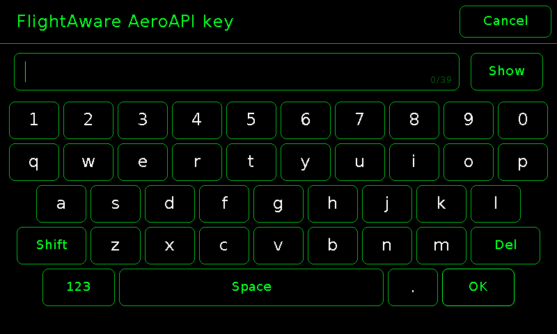

Enter the key on the radar (*API Key*, on-screen keyboard) or on the phone page (a password box), then press *Test Key*: the radar answers *Key accepted* or *Key rejected (401)*. The key is stored in the radar's flash
like your Wi-Fi password, is never shown again and is sent only to FlightAware. *Remove key* on the page deletes it.
On the card: *Took off 14:05*, *ETA 17:20 (+13 min)*, a progress bar and FlightAware's status (*En Route / Delayed*); times are in your local time. A tilde means estimated, "(sch)" means only the schedule is known.

**Photos (Planespotters).** Needs only a contact e-mail address (*Contact Email*): Planespotters asks API users to identify themselves, and the radar puts the address in the request's User-Agent. The photo is
shown under the card with the photographer's name; if there is none for that aircraft, nothing is shown.

## SD card logging
With a FAT-formatted microSD card (up to 64 GB tested) the radar writes, in `/adsb`: `YYYY-MM-DD.csv` (one row per aircraft per 10 / 30 / 60 s: `time_utc,hex,callsign,lat,lon,alt_ft,gs_kt,track,squawk`) and `sys-YYYY-MM-DD.log`
(boots with the reason, data and Wi-Fi events, emergencies, an hourly health line). Writing happens in the background in whole batches, so pulling the card loses at most a few seconds; it is remounted by itself when it comes back.
The oldest day files are deleted when less than 10 % of the card is free. *Eject* (Log tab or page) flushes everything first. *View Logs* shows the end of a file on the radar.

## Updating the firmware
See [BUILDING.md](BUILDING.md#updating-over-wi-fi). The page section *Firmware* shows the running slot and whether the firmware is *pending* (still on trial) or *valid*.

## Troubleshooting
| What you see | What to do |
|---|---|
| *Connecting* / *No Data* on the radar | The status line says why: *No Wi-Fi* (see Settings > Wi-Fi), *Waiting for time sync* (needs internet for the clock), *Certificate error* (the clock is wrong or something is intercepting HTTPS), *Rate limited (429)* (wait; do not shorten the poll interval) |
| No aircraft, but *Live ADS-B* | Normal in thin airspace: raise the range, or check the location |
| `radar.local` does not open | Use the IP address from Settings > Wi-Fi. Some Windows setups need Apple's Bonjour for `.local` names. The phone and the radar must be on the same network |
| Forgot the web PIN | It is always shown on the radar, Settings > Wi-Fi > Web PIN |
| Wrong units or time zone | Settings > Location: country and time zone follow the location unless set by hand ("Automatic" puts them back); Settings > Units |
| A flickering line or a one-frame jump | The display recovers from a late interrupt within one frame by design; frequent glitches during Wi-Fi activity: try *System > Display Mode* |
| Photo or FlightAware line says an error | The *Flights Data > Last Lookup* row (and the card) show it: *Key rejected (401)* wrong key, *Limit reached (429)* too many calls, *No flight found* the callsign has no flight plan (private and military flights usually have none) |
| The radar restarted by itself | The SD log (if present) says why: the boot line names the reset reason and which task was where; "planned restart" means you or an update caused it |

## What the radar sends, and to whom
| To | What | Why |
|---|---|---|
| airplanes.live | your radar's latitude, longitude (4 decimals) and range, every 5 seconds | the aircraft list. **They therefore know the approximate location of your radar**: place it at a nearby public spot if that matters |
| adsbdb.com | the callsign of the aircraft you tap | route |
| FlightAware (only if enabled) | the callsign / flight id of the aircraft you tap, with your API key | times, track |
| Planespotters (only if enabled) | the ICAO address of the aircraft you tap, and your contact e-mail in the User-Agent | photo |
| NTP servers (`pool.ntp.org`, `time.google.com`) | the normal time request | the clock (needed for HTTPS certificate checks and the local time) |

Nothing is sent anywhere else, and the web page you open from a phone loads nothing from third parties except OpenStreetMap map tiles on the location picker.
